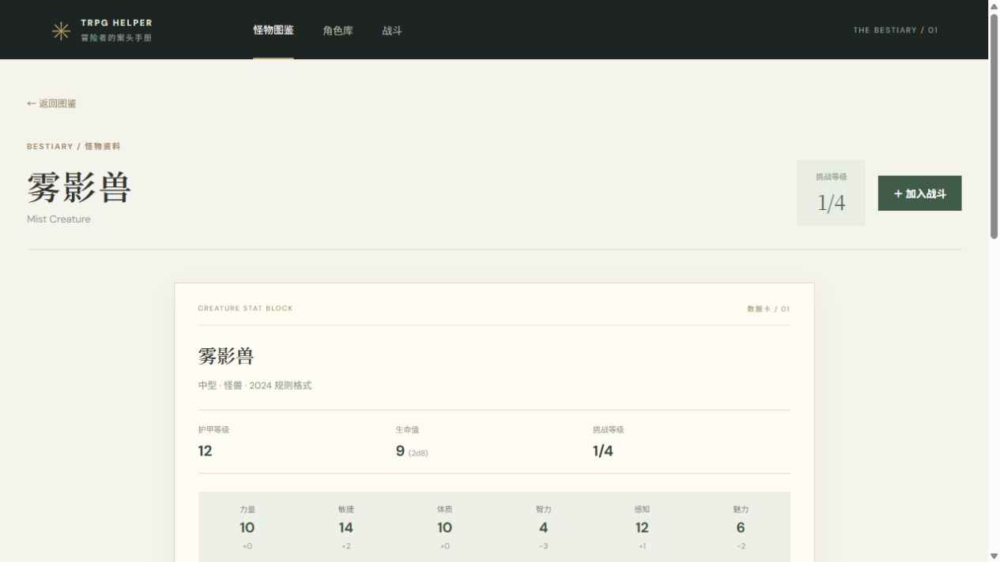

# TRPG Helper

一个本地运行的 D&D 角色与资料工具。怪物图鉴、法术库、角色库和战斗相互独立；角色发布后可作为快照加入战斗。

## 界面示例

**法术库**：按名称、环阶、学派和职业筛选；展开条目可查看已匹配的描述及来源。


以下截图展示角色、怪物和战斗的基本操作，使用虚构示例数据；界面可能随版本更新。

**角色卡**


**怪物数据卡**



**战斗**


## 快速开始

需要 Node.js 和 pnpm。在项目根目录执行：

```sh
pnpm install --frozen-lockfile
pnpm dev
```

在浏览器打开终端显示的本地地址，通常是 <http://127.0.0.1:5173/>。如果 5173 端口已被占用，请使用终端实际显示的地址。

仓库自带少量原创怪物示例。法术列表、完整怪物资料和部分职业特性索引需要单独导入；执行导入命令时需要联网，日常浏览读取本地文件。建议首次使用前在项目根目录按需运行：

```sh
pnpm import:origin-spells       # 八个施法职业的法术索引
pnpm import:spell-descriptions # 可匹配的英文 SRD 法术描述
pnpm import:monsters           # 参考站点怪物资料
pnpm import:classes            # 职业特性名称索引
pnpm import:subclasses         # 子职业特性名称索引
```

导入完成后刷新页面；如果开发服务未识别到新文件，请重启 `pnpm dev`。导入的数据文件被 Git 忽略，不随仓库分发。导入脚本可能遗漏或错误识别内容，请查看来源核对；分享或发布资料前应确认其使用权限。

## 使用示例

### 创建角色并选择法术

1. 打开 **角色库 → 新建角色**，填写名字，选择物种、职业、等级和可用的子职业。
2. 在属性生成中选择 **27 点购点**或 **Roll**；选择背景并分配符合背景的属性加值。规则计算模式会根据已支持的选项计算生命、护甲、速度和部分熟练与特性。
3. 按页面提示选择职业技能、起源选项和其他已接入的特性。法术下拉列表需要先运行 `pnpm import:origin-spells`。
4. 例如创建法师时，先在“法术书”中选择已知法术，再选择准备法术；法师可计算抄录法术书所需的时间与费用。角色的法术位、部分职业资源及物种能力可在草稿中记录使用次数。
5. 保存草稿并在完成必填项后发布。发布版本保留当时的角色快照；之后编辑草稿不会修改已有版本。可在角色库导出或导入 JSON 备份。

新角色使用 27 点购点或 Roll；旧版手动角色仍可查看，且可在编辑页启用规则计算。法术替换时机、部分来源和装备等仍需自行核对。

### 查找怪物与法术

- 在 **怪物图鉴**输入中英文名称，或按类型、挑战等级和栖息地筛选。打开怪物后可查看数据卡、原始文本和来源链接；导入数据缺失时会显示原创示例。
- 在 **法术库**输入名称，或按环阶、学派、职业筛选。展开条目可查看已匹配的英文描述；未匹配的条目可打开来源。索引和描述各自通过上述命令生成。

### 将角色和怪物加入战斗

1. 在角色卡中将**已发布版本**导入已有或新建战斗，并选择阵营。
2. 在怪物数据卡中选择“加入战斗”，选择战斗、阵营和数量。
3. 在 **战斗**页面投掷先攻（留空自动投掷，也可手工填入），开始后按先攻顺序逐单位行动。

回合内可标记动作、附赠动作、反应与移动，记录临时生命和状态，并在攻击面板中选择目标、攻击加值、伤害骰与伤害类型。攻击会自动掷 d20（支持优势／劣势）、比较 AC、结算重击、抗性／易伤／免疫、临时生命、倒地与死亡；角色在 0 点生命值时可以投死亡豁免。每一步都可以撤销，战斗日志会保留掷骰明细。

战斗单位是导入时的独立副本。战斗内的生命值变化不会改动原角色或怪物；编辑角色草稿也不会更新已导入的副本。开始战斗后不能再向该战斗添加单位，需要先重置战斗。

## 当前功能与限制

- **角色和起源**：支持 2024 核心物种、16 个玩家手册背景、12 个职业和各职业的四个子职业选项；可按规则计算已接入的属性、技能、豁免、部分感官、移动和物种／职业特性。并非所有特性效果都已自动化。
- **施法与资源**：支持八个施法职业以及奥法骑士、奥术诡术师的部分法术选择和单职业法术位；法师法术书、邪术师秘法、吟游诗人魔法奥秘等提供部分选择。可记录部分职业、物种及法术位资源，并通过短休或长休恢复已支持的项目；20 级牧师可记录进阶神圣干预的祈愿术和所需长休次数。可选择的恢复、法术替换时机和部分效果仍须自行核对。
- **法术描述**：名称、学派和环阶来自本地导入索引；已匹配的描述来自 Wizards of the Coast LLC 的 [SRD 5.2](https://www.dndbeyond.com/srd)，采用 [CC BY 4.0](https://creativecommons.org/licenses/by/4.0/) 授权，通过[结构化资料](https://gist.github.com/dmcb/4b67869f962e3adaa3d0f7e5ca8f4912)导入。未匹配的条目不保证有描述。
- **战斗**：支持先攻排序、回合推进、动作／附赠动作／反应／移动记录、单次与连续攻击（优势／劣势、状态修正、自动重击、重击、抗性／易伤／免疫、临时生命、倒地与死亡豁免）、多次攻击与动作如潮／回气、逐目标豁免与范围伤害、回合开始的持续伤害与专注检定、召唤物与专注联动、状态标记、方格战场与距离校验、半掩体／四分之三掩体（远程连线上挡着其他在场单位时也算半掩体）、攻击提示（提交前汇总视线、生物掩体、黑暗／云雾、天气与高差修正）、撤离战场（一键退出战斗，不再占回合也不计入胜负判定，之后不再出现在攻击目标与法术目标列表里，也不再占格或挡枪）、投降（退出回合但留在战场，可被搜刮并计入击败经验；战报与 CSV 的状态列会标注「已投降」「已撤离」，受到实际伤害会立刻重新投入战斗）、处决俘虏（动作，处决 5 尺内已投降的单位）、士气检定（感知豁免 DC 12，失败即放下武器投降）、倒地爬行（倒地时每格消耗 10 尺移动力）、临时伤害抗性／免疫／易伤面板（按伤害类型设置，传空即清除，Markdown 战报会单列「防御」小节）、离开触及范围时的借机攻击提示（可用反应结算或放弃）、可点击标记的困难地形（进入时移动消耗翻倍）、可点击标记的墙体（阻挡移动；远程攻击的连线被墙体挡住时直接拒绝并提示换用近战或调整位置）、撤离（消耗动作换取移动不引发借机攻击）、战术建议（按能否攻击／目标血量／平均伤害排序并一键填入攻击表单，已撤离或投降的单位不再参与推荐）、按墙体自动判定掩体、准备动作（动作换反应，触发条件自定）、附带额外伤害（如猎人印记）、战斗中增援（按先攻插队）、起身（消耗一半移动力）、持续效果的回合开始／结束时机、战果与经验结算（按挑战等级）、重型武器力量不足时攻击劣势、两用武器双手伤害骰、远程武器超常规射程劣势、轻型武器可作副手攻击（附赠动作）、装填武器每次动作只能射击一次、双武器战斗风格把调整值加到副手伤害、擒抱与推撞（力量对抗，被擒抱无法移动，可花动作挣脱；推撞可把目标推入岩浆／陷阱／荆棘／油污并照常结算该格后果；战场可切换为水下（远程攻击劣势、超 30 尺自动失手、火焰伤害减半、游泳移动消耗翻倍）、攀爬（移动消耗翻倍）或冰面（移动消耗翻倍，移动后敏捷豁免 DC 10，失败倒地），或岩浆（踏入与回合开始受 1d10 火焰伤害，移动消耗翻倍）、荆棘（移动消耗翻倍，每移动 5 尺受 1 点穿刺伤害）、油腻术与蛛网术（范围格子：油污 DC 13 敏捷豁免失败倒地，蛛网 DC 12 失败束缚并可用动作挣脱）、雾云术（范围迷雾为重度遮蔽，雾内外互攻时攻击检定劣势，随专注消散）、沉睡术（5d8 生命值池按血量由低到高使目标失能倒地，受伤或唤醒解除）、沉默术（3×3 区域禁止言语施法，区域内无法施放法术，随专注消散）、定身术（60 尺内感知豁免 DC 13，失败麻痹 10 轮，每回合开始重掷豁免，随专注消散）、命令术（60 尺内感知豁免 DC 13，失败则立刻倒地或失去下一个回合）、黑暗术（1–12 格魔法黑暗，看不清目标时攻击劣势且无法借机攻击）、缓慢术（40 尺内最多 6 个敌人做感知豁免，失败者速度减半、AC -2、无法使用反应）、魅惑术（30 尺内敌人感知豁免 DC 13，被魅惑者无法攻击施法者）、恐惧术（30 尺内 3 个敌人感知豁免 DC 13，恐慌者无法靠近施法者且对其攻击劣势）、投掷圣水与炽火胶（20 尺远程攻击，圣水 2d6 光耀；炽火胶 1d4 火焰并附加持续伤害）、驱散魔法（120 尺内 DC 13 施法属性检定，成功后解除目标身上的法术增益与减益）、中毒与解毒剂（体质豁免 DC 13，中毒者攻击与属性检定劣势，可用解毒剂解除）、睡眠云（3×3 区域，站在其中每回合做感知豁免 DC 13，失败陷入沉睡）、突袭（标记措手不及的单位第一回合直接跳过）、天气（暴雨：远程攻击劣势且火焰伤害减半；强风：远程攻击劣势并可能吹落飞行单位）、变形术（DC 13 感知，失败变成小兽：失能、AC 10、速度 25 尺）、泥沼（移动消耗翻倍，移动后 DC 12 敏捷豁免，失败倒地）、群体治疗术（附赠动作，60 尺内至多 6 个友方各恢复 1d4+施法属性）、援助术（动作，至多 3 个友方生命上限 +5，长休后失效）、致盲术（动作 + 专注，30 尺内单体体质豁免 DC 13，失败目盲 10 轮）、纠缠术（动作 + 专注，1–16 格藤蔓：移动消耗翻倍，力量豁免 DC 13 失败被束缚，回合末可再豁免、也可花动作强行挣脱）、耳聋术（动作 + 专注，30 尺内单体体质豁免 DC 13，失败耳聋 10 轮：听不见命令术、也无法接受或提供协助）、树肤术（动作 + 专注，目标 AC 不低于 17，持续 10 轮）、瞄准（附赠动作，下一次远程攻击检定优势）、法术卷轴（动作 + 施法属性检定 DC 10+环阶，失败卷轴损毁）、架设掩体（动作，占据工事格获得半掩体 AC +2）、抄写卷轴（动作 + 1 张空白羊皮纸，抄出 1 环卷轴）、摧毁掩体（动作 + 力量运动 DC 15，破除相邻格工事）；方格可标记危险地形（进入即受伤，回合开始时仍站在其中会再次受伤））、自动行动（射程内攻击／射程外靠近并绕过危险地形、优先补刀残血，动作攻击后会用轻型武器追加副手攻击，无法行动的单位原地待命、靠近不了时改用闪避；先攻栏可直接改数字重排、回合内可掷属性检定、用动作治疗队友或用 DC 10 医药检定稳定倒地队友，也可用动作施放祝福术（最多 3 名友方 10 轮内攻击检定与豁免 +1d4）或用反应施放护盾术（AC +5 直到自己下个回合开始），或用动作施放加速术（10 轮内速度翻倍、AC +2、敏捷豁免优势）与隐形术（针对它的攻击检定劣势、它自己的攻击检定优势），两者都需维持专注，也可「延迟行动」把自己挪到本轮最后；单位死亡会自动移除它的灵光、中断专注并驱散召唤物；游荡者／武僧 7 级起敏捷豁免成功时完全免伤；游荡者每回合可叠加一次偷袭骰（优势或同伴贴身时触发，随重击翻倍），2 级起可用附赠动作执行灵巧疾跑／撤离／躲藏；野蛮人可用鲁莽攻击换取本回合攻击优势（同时敌人也获得优势）；三面墙挡住的单位会被判为全掩体而无法被直接攻击）与自动回合（默认最多 8 步，可一键推进到回合结束、也可整轮批量推进同一阵营）、坠落伤害（每 10 尺 1d6）与跳远／跳高估算、法术施放（攻击或豁免结算，可建立专注）、战斗结算摘要（可直接回写角色卡）、灵光（半径内同阵营单位的 AC／豁免加值）、弹药消耗与补充、投掷武器（长矛／手斧／轻锤，超出常规射程劣势）、掩体对敏捷豁免的加值（半掩体 +2／四分之三掩体 +5）、武器精通（长剑／长矛削韧、战锤推撞、长弓／标枪迟滞、短剑／刺剑破绽、长棍倾覆、巨剑擦伤、巨斧顺劈、匕首迅击；重型武器可开「强力攻击」以攻击 -5 换伤害 +10；远程／投掷武器可开「神射手」忽略半掩体与超出常规射程的劣势；可开启「回合开始自动掷死亡豁免」、以及「长武器进入触及时借机」；施法可记录并按环扣除法术位；战场可设为轻度／重度遮蔽（重度遮蔽使攻击检定劣势）；工具栏「长休恢复」可一键还原法术位、职业资源与弹药；回合面板可为每个单位标记力竭等级（每级攻击／豁免／检定 -2、速度 -5 尺）；勇士冠军的重击范围会按等级自动扩到 19–20／18–20（可在攻击表单手动指定）；敌人贴身时远程攻击会自动带劣势；方格面板可选「跳跃移动」按直线距离跳过去（忽略困难与危险地形）；协助既可给同伴攻击优势，也可给其下一次属性检定优势；处于高空时可一键「跳下」按坠落规则结算伤害；回合面板可切换「飞行」（忽略地形消耗与危险地形伤害），可开关「双持战斗者」（AC +1，副手可用非轻型武器）与「防守决斗」（花反应让自己 AC 加熟练值）、物品记录与使用（治疗骰按本地掷骰结算，未鉴定物品需先花动作鉴定）、搜刮阵亡单位与向同伴传递物品、常用攻击预设（可带神射手／强力攻击／双手持用参数）、战斗日志（可按轮次与关键字筛选）、撤销、档案导入导出与 Markdown 战报（含每人物品与常用攻击）。伤害骰与攻击加值可从怪物动作文本、角色「攻击与法术」文本和装备武器自动解析，也可在攻击面板改写；启用方格后近战按触及范围、远程按 600 尺校验距离，未放置的单位仍按手工距离结算；掩体由操作者选择，自动按 AC +2／+5 结算；借机攻击按触发瞬间的触及关系出刀并消耗反应。目前不提供武器专长与附伤的完整自动化、自动仇恨／AI、地形与视线的自动判定。
、非致命攻击（近战命中可把目标打晕而非杀死）、掩护射击（动作 + 敏捷 DC 15，被压制的敌人攻击检定劣势到它回合结束）、遭遇难度评估（按存活敌人的挑战等级经验对照队伍预算，给出低／中／高／致命）、骑乘（5 尺内同阵营坐骑可一键骑上，速度改取坐骑，坐骑倒下时骑手落马）、战斗统计（逐单位记录攻击／命中／重击／造成与承受伤害／治疗，工具栏显示轮次摘要与伤害类型构成，超出前几名合并为「其他」；Markdown 战报也会附统计表，统计可导出 CSV）
- **规则覆盖**：不支持完整的 2024 规则向导、兼职、全部装备和魔法物品效果。逐项进度见 [2024 角色非战斗特性核对清单](docs/2024角色非战斗特性核对清单.md)；“可选”或“有说明”不代表该特性已完全自动执行。

角色和战斗保存在当前浏览器的本地存储中，不会自动同步到其他浏览器或设备。清除站点数据会删除本地记录，请使用角色库的 JSON 导出功能备份角色；战斗可在战斗页底部的「导入 / 导出战斗」卡片中单独导出为 JSON 或 Markdown 战报。

## 开发和数据来源

```sh
pnpm test  # 运行测试
pnpm build # 类型检查并构建前端
```

怪物导入脚本位于 `scripts/import-monsters.cjs`，会生成本地怪物数据和导入报告；抓取或基础字段校验出错时不会覆盖已有数据。怪物数据加载时通过 `packages/contracts/schemas/monster-entry.schema.json` 校验，不符合格式的条目会被跳过并显示错误。

属性生成和部分规则参考 [System Reference Document 5.2.1](https://www.dndbeyond.com/srd)。本项目为辅助工具，自动提取的数据和未实现的规则应以所用规则来源及主持人的裁定为准。


