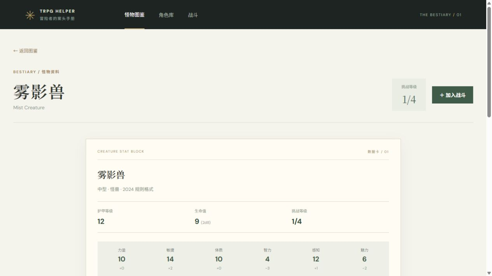

# TRPG Helper

一个本地运行的 D&D 角色与资料工具。怪物图鉴、法术库、角色库和战斗准备相互独立；角色发布后可作为快照加入战斗。

## 界面示例

**法术库**：按名称、环阶、学派和职业筛选；展开条目可查看已匹配的描述及来源。


以下截图展示角色、怪物和战斗的基本操作，使用虚构示例数据；界面可能随版本更新。

**角色卡**


**怪物数据卡**



**战斗准备**


## 快速开始

需要 Node.js 和 pnpm。在项目根目录执行：

```sh
pnpm install --frozen-lockfile
pnpm dev
```

在浏览器打开终端显示的本地地址，通常是 <http://127.0.0.1:5173/>。如果 5173 端口已被占用，请使用终端实际显示的地址。

仓库自带少量原创怪物示例。法术列表、完整怪物资料和部分职业特性索引需要单独导入；执行导入命令时需要联网，日常浏览读取本地文件。建议首次使用前在项目根目录按需运行：

```sh
pnpm import:origin-spells       # 八个施法职业的法术索引
pnpm import:spell-descriptions # 可匹配的英文 SRD 法术描述
pnpm import:monsters           # 参考站点怪物资料
pnpm import:classes            # 职业特性名称索引
pnpm import:subclasses         # 子职业特性名称索引
```

导入完成后刷新页面；如果开发服务未识别到新文件，请重启 `pnpm dev`。导入的数据文件被 Git 忽略，不随仓库分发。导入脚本可能遗漏或错误识别内容，请查看来源核对；分享或发布资料前应确认其使用权限。

## 使用示例

### 创建角色并选择法术

1. 打开 **角色库 → 新建角色**，填写名字，选择物种、职业、等级和可用的子职业。
2. 在属性生成中选择 **27 点购点**或 **Roll**；选择背景并分配符合背景的属性加值。规则计算模式会根据已支持的选项计算生命、护甲、速度和部分熟练与特性。
3. 按页面提示选择职业技能、起源选项和其他已接入的特性。法术下拉列表需要先运行 `pnpm import:origin-spells`。
4. 例如创建法师时，先在“法术书”中选择已知法术，再选择准备法术；法师可计算抄录法术书所需的时间与费用。角色的法术位、部分职业资源及物种能力可在草稿中记录使用次数。
5. 保存草稿并在完成必填项后发布。发布版本保留当时的角色快照；之后编辑草稿不会修改已有版本。可在角色库导出或导入 JSON 备份。

新角色使用 27 点购点或 Roll；旧版手动角色仍可查看，且可在编辑页启用规则计算。法术替换时机、部分来源和装备等仍需自行核对。

### 查找怪物与法术

- 在 **怪物图鉴**输入中英文名称，或按类型、挑战等级和栖息地筛选。打开怪物后可查看数据卡、原始文本和来源链接；导入数据缺失时会显示原创示例。
- 在 **法术库**输入名称，或按环阶、学派、职业筛选。展开条目可查看已匹配的英文描述；未匹配的条目可打开来源。索引和描述各自通过上述命令生成。

### 将角色和怪物加入战斗

1. 在角色卡中将**已发布版本**导入已有或新建战斗，并选择阵营。
2. 在怪物数据卡中选择“加入战斗”，选择战斗、阵营和数量。
3. 在 **战斗**页面查看单位，手动调整生命值或移除单位。

战斗单位是导入时的独立副本。战斗内的生命值变化不会改动原角色或怪物；编辑角色草稿也不会更新已导入的副本。

## 当前功能与限制

- **角色和起源**：支持 2024 核心物种、16 个玩家手册背景、12 个职业和各职业的四个子职业选项；可按规则计算已接入的属性、技能、豁免、部分感官、移动和物种／职业特性。并非所有特性效果都已自动化。
- **施法与资源**：支持八个施法职业以及奥法骑士、奥术诡术师的部分法术选择和单职业法术位；法师法术书、邪术师秘法、吟游诗人魔法奥秘等提供部分选择。可记录部分职业、物种及法术位资源，并通过短休或长休恢复已支持的项目；20 级牧师可记录进阶神圣干预的祈愿术和所需长休次数。可选择的恢复、法术替换时机和部分效果仍须自行核对。
- **法术描述**：名称、学派和环阶来自本地导入索引；已匹配的描述来自 Wizards of the Coast LLC 的 [SRD 5.2](https://www.dndbeyond.com/srd)，采用 [CC BY 4.0](https://creativecommons.org/licenses/by/4.0/) 授权，通过[结构化资料](https://gist.github.com/dmcb/4b67869f962e3adaa3d0f7e5ca8f4912)导入。未匹配的条目不保证有描述。
- **战斗准备**：目前支持添加和移除单位及手动调整生命值，不提供先攻排序、回合调度、自动伤害或法术效果结算。
- **规则覆盖**：不支持完整的 2024 规则向导、兼职、全部装备和魔法物品效果。逐项进度见 [2024 角色非战斗特性核对清单](docs/2024角色非战斗特性核对清单.md)；“可选”或“有说明”不代表该特性已完全自动执行。

角色和战斗保存在当前浏览器的本地存储中，不会自动同步到其他浏览器或设备。清除站点数据会删除本地记录，请使用角色库的 JSON 导出功能备份；该功能不包含战斗记录。

## 开发和数据来源

```sh
pnpm test  # 运行测试
pnpm build # 类型检查并构建前端
```

怪物导入脚本位于 `scripts/import-monsters.cjs`，会生成本地怪物数据和导入报告；抓取或基础字段校验出错时不会覆盖已有数据。怪物数据加载时通过 `packages/contracts/schemas/monster-entry.schema.json` 校验，不符合格式的条目会被跳过并显示错误。

属性生成和部分规则参考 [System Reference Document 5.2.1](https://www.dndbeyond.com/srd)。本项目为辅助工具，自动提取的数据和未实现的规则应以所用规则来源及主持人的裁定为准。
