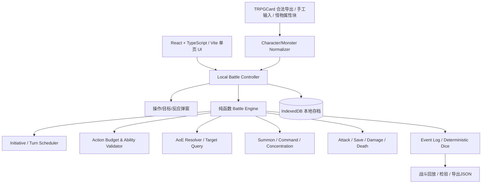

# D&D 5E 单机多人战斗引擎——完整技术设计文档

> 版本：**v2.0**（2026-11-10）  
> 规则基线：**D&D 2024 / SRD 5.2.1**；2014 / SRD 5.1 单独规则包适配  
> 操作方式：**同一台设备、一个界面、多人单位轮流手动操作；不要求多人联网**  
> 核心覆盖：多个 PC、怪物、召唤物；AoE 多目标逐个结算；行动/附赠动作/反应；职业与怪物特殊能力；死亡及胜负。  
> 性质：可实施的产品与架构设计，不是已经运行的应用；TRPGCard 接口是否可用仍需验证。

## 0. 修订说明与关键决策

本文件完整替代 v1.0《双玩家 PvP 战斗系统设计文档》。**不再以“两名玩家每人一张角色卡、双客户端 WebSocket”为核心模型**，而是采用单机「多阵营 × 多单位 × 多操作角色」设计。

| 方面 | v1.0 | v2.0 |
|---|---|---|
| 作战规模 | 两个主 PC + 召唤物 | 任意数量 PC、NPC、怪物、召唤物、持久区域效果 |
| 操作者 | 两端各自操作 | 单个本地用户界面，**每个决策都通过选择窗口确认具体单位与指令** |
| 多人联网 | 双端同步为 P0 | **首版完全不需要**；联网预留为远期可选适配层 |
| 阵营 | A、B 两方，按主 PC 胜负 | `Side[]`，可 2+ 阵营，自定义存活、全灭、撤退等胜负规则 |
| AoE | 具有区域效果能力 | **必需：确定范围、列出所有受影响者（含召唤物）、逐目标豁免/伤害/状态处理** |
| 职业 | 示例能力 | **P0 直接覆盖 Extra Attack、Action Surge、Second Wind 与数个代表能力** |
| 附赠动作 | 独立预算 | **硬性不变量：单位一个自身回合最多 1 次；Action Surge 永不增加额度** |
| 怪物 | 简单 Actor | 标准属性块、Multiattack、Recharge、Reaction；传奇/巢穴动作分阶段支持 |

**设计边界**：玩家/主持人决定战术动作；程序负责检查是否合法、掷骰、结算、展示日志。对于无法由结构化规则处理的行为，提供「人工裁定并记录原因」入口，而不是由大模型随意判定。第一版的动作顺序默认严格遵循先攻；“自由选择任意单位行动”只能作为显式开启的**房规模式**。

## 1. 产品目标与范围

### 1.1 必须完成的功能（P0）

1. 在战斗中添加/移除任意数量的 **PC、怪物及召唤物**，分属至少两个阵营；怪物可手工创建，也可从规则包/属性块导入。
2. 先攻排序，逐单位行动。每次提交指令前，弹出**操作选择窗口**，明确“哪个单位在做什么、选择哪个目标/区域、消耗什么资源”。在反应窗口可切到其他有资格响应的单位，但不改变正常先攻。
3. 普通动作、附赠动作、反应、移动、攻击序列、职业资源**分别结算**；附赠动作严格限一次，不能由普通动作替代，也不会因动作如潮获得第二次。
4. 支持 PC 的单次攻击、额外攻击、动作如潮、回气；支持怪物的 Multiattack 和至少一种 Recharge 能力。
5. 单目标与 AoE：球形、锥形、立方体、线形；范围中所有 PC、怪物、召唤物均可成为候选；按规则分别命中/豁免、伤害、状态与死亡结算。
6. 召唤物能拥有自己的状态、行动权限、行动时序、指挥代价；召唤者的资源成本与召唤物的行动资源分离；专注结束按来源清除相应召唤物。
7. 处理优势/劣势、AC、攻击和豁免、暴击、伤害类型、抗性/易伤/免疫、临时 HP、0 HP、死亡豁免、专注与胜负。
8. 本地保存、导出/导入对局 JSON、完整日志、撤销上一步（有明确历史分叉标记），支持固定骰子流重放测试。

### 1.2 后续扩展（P1/P2）

- P1：完整二维方格地图和地形、掩护、视线、完整移动与借机攻击；持续 AoE；怪物传奇动作/巢穴动作；更多职业及子职业能力；多个轮次定时触发。
- P1：由工具校验的近战/法术攻击自动目标提示与范围预览；存档场景模板。
- P2：2014 规则包、非 SRD 内容、规则编辑器、复杂坐骑、飞行/垂直距离、联合施法、联网多人及权限控制。

**重要产品分级**：若 P0 不实现精确地图，必须提供「无地图的目标确认模式」，清楚标记范围有效性由操作者申报，不能谎称系统自动验证墙体、遮蔽、精确距离。正式追求严格规则时使用地图验证模式。

### 1.3 非目标

- 不自动指挥 PC 或怪物（除法术明确规定的自动行为与状态效果）。
- 不伪称已经覆盖全部 D&D 5E 扩展规则。
- 不要求用户登录、组队、上传私人角色资料或启动远程服务器。
- 不抓取 TRPGCard 未公开、需越权访问的数据。

## 2. 领域概念及边界

| 概念 | 解释 |
|---|---|
| **Battle** | 一场战斗，包含规则版本、阵营、单位、先攻、地图/无地图配置、效果和事件 |
| **Side** | 阵营：友敌关系、控制归属与胜负统计；允许 2 个以上 |
| **Actor / Unit** | 可参与行动和承受效果的生物单位；PC、怪物、召唤物走同一机制 |
| **Principal PC** | 玩家角色；不是所有阵营都必须拥有 PC（例如全怪物敌方队） |
| **Monster** | 使用怪物属性块与专属动作的单位；不自动继承 PC 职业特性 |
| **Summon** | 有实体的生物；拥有自己的 HP、AC、状态、部分或全部行动资源 |
| **AreaEffect** | 非生物的持续性区域效果；不掷先攻也不拥有 HP（除非来源明确将其实体化） |
| **Controller** | 操作某单位指令的人/抽象控制者；本版本所有操作都在同一 UI，但操作日志记名 |
| **Owner / Source** | 召唤物或效果的来源，和当前控制者不同；用于专注、持续时间、消失、指挥成本 |
| **Turn** | 单个单位的回合，不等于 Round（所有先攻位走完一轮） |
| **Reaction Window** | 可暂停的待决窗口；本地弹出符合条件的单位与反应供手动确认 |
| **RulePack** | 规则版本和能力定义，战斗开始后冻结具体版本/hash |

**对象分类原则**：所有能承受伤害的召唤生物都在 `actors` 集合中；所有 AoE 的候选生物从该集合统一查询，不允许只遍历 `PC[]` 或 `monsters[]`。怪物的宠物、敌方召唤物、第三方中立单位同样可以被选中/受影响。

## 3. 界面与交互设计：每次操作弹出选择窗口

### 3.1 战斗主界面

```text
┌──────────── 战斗 #42 / Round 3 / 当前：战士 A ────────────┐
│ 阵营列表：[红队 3 单位] [蓝队 4 单位] [中立 1 单位]        │
├────────────────────── 地图/单位表 ──────────────────────┤
│   A 战士      A2 魔宠        B 骷髅1 B 骷髅2             │
│   A 法师            [火墙区域]    B 巨魔  B1 召唤兽     │
├────────────────────── 当前回合 ────────────────────────┤
│ 战士 A：HP 35/43，AC 18，动作 1，附赠动作 1，反应 1      │
│ [选择操作] [结束回合]   召唤列表/职业资源/法术位          │
├─────────────────── 事件与逐目标结果 ───────────────────┤
│ 火球术：骷髅1 DEX 失败/23火伤；召唤兽 DEX成功/11火伤   │
│          法师队友 DEX成功/11火伤；骷髅2 不在范围          │
└───────────────────────────────────────────────────────┘
```

### 3.2 统一「选择操作」弹窗（必做）

**每次玩家发起新指令，统一使用以下表单，而不是靠鼠标点单位后隐式执行：**

```text
┌────────────── 选择本次操作 ───────────────┐
│ ① 当前阶段：正常行动 / 待决反应 / 触发窗口 │
│ ② 操作单位： [战士 A ▼]                   │
│    列表只显示当前时机合法的单位            │
│ ③ 操作类型： (普通动作) (附赠动作)         │
│               (移动) (反应) (特殊)         │
│ ④ 能力： [攻击—长剑 ▼]                    │
│    来源：战士 Lv5 / 装备；剩余攻击：2/2    │
│ ⑤ 目标/区域： [目标选择...]               │
│ ⑥ 成本预览：普通动作 ×1，附赠动作 ×0       │
│ ⑦ 检查：合法 ✓  （非法时说明原因）        │
│ [取消]                       [确认执行]    │
└─────────────────────────────────────────┘
```

- **合法操作单位**：正常回合默认只允许当前先攻单位，以及规则明确允许的“共同回合受控单位”；不允许任意跳转到其他 PC/怪物。反应窗口允许当前满足触发条件的其他单位响应。
- **操作单位与操作者分离**：事件要记录 `actorId` 和 `operatorLabel`（例如“玩家甲”“GM”），以便在同机轮流点击时追溯。
- **动态过滤**：普通动作 0 时不再提供消耗普通动作的选项；附赠动作已经使用后，不再提供任何要求支付附赠动作的能力；召唤物无命令则按自身政策限制。
- **附赠动作按钮不可泛化**：只有具体职业/装备/法术提供能力时才显示；“有一个附赠动作额度”不意味着可以用它进行任何动作。
- **放弃与返回**：弹窗在确认前取消不消耗资源；确认后进入事件队列，不允许通过关闭窗口免费撤销已经支付的代价。

### 3.3 反应/特殊触发弹窗

如怪物 A 攻击法师 B，命中后打开“是否施放护盾术”的反应窗口：系统列出所有合格响应单位及每个单位可用的反应；操作者选择“法师 B → 护盾术”或“放弃”。按规则允许多个角色或多种反应时，依触发与顺序规则处理，不能简单让所有角色各自多用一次反应。弹窗必须显示触发来源、反应成本与可能改变的结果。

### 3.4 AoE 专用弹窗

当选择火球术等 AoE：

1. 选择法术和法术位/使用次数。
2. 选择**范围中心/方向/模板**，若无地图则进入“手动申报受影响单位模式”。
3. 在表格中列出全部 PC、怪物、召唤物及其他可被该效果影响的目标，并标注：阵营、位置、是否受影响、被排除理由。
4. 对于火球术这种 **ALL_IN_AREA** 效果，受影响者的勾选框为**只读**，不能为了只伤害敌人而随意取消友军；拥有明确排除能力（如塑能法术）的角色可在合法限制内单独选择豁免对象。
5. 对于 **CHOOSE_N / CHOOSE_UP_TO_N** 类法术，用户可以手动勾选符合目标条件的 PC、怪物或召唤物，系统校验数量、距离、视线与阵营等。
6. 确认后锁定本次瞬时效果的目标快照，再进入逐个对象的豁免/伤害结算；持续区域效果则在对应触发时重新判断目标。

AoE 结果弹窗提供“**目标 → 掷骰 → 成败 → 原始伤害 → 抗性/减免 → 临时 HP → 真实 HP → 状态/死亡/专注**”逐单位展开，不要只有总伤害一行。

## 4. 技术架构（完全本地优先）



推荐技术栈：

- **React + TypeScript + Vite**：单页面战斗 UI 与弹窗。
- **规则核心 `rules-core`**：无 DOM、网络、数据库依赖的纯 TypeScript 函数；确定性规则计算与测试。
- **Zustand（可选）**：仅保存 UI 层的选中单位、弹窗状态；权威战斗状态由本地 Controller 按命令提交，避免组件自行扣血。
- **IndexedDB（Dexie 可选）**：本地战斗快照及事件日志；支持离线使用和 JSON 导出。
- **规则 Schema**：JSON + JSON Schema/Zod 校验；禁止任意动态 `eval`。
- **地图**：P0 可用网格 + 目标确认模式；P1 使用 SVG/Canvas 完成精确位置与范围显示。
- **可选桌面封装**：Tauri + SQLite，不影响规则核心。无需 Node 服务器和 WebSocket；将来联网再增加适配器。

推荐目录：

```text
apps/web/src/
  components/BattleBoard.tsx
  dialogs/ActionSelectionDialog.tsx
  dialogs/TargetSelectionDialog.tsx
  dialogs/AoESelectionDialog.tsx
  dialogs/ReactionDecisionDialog.tsx
  panels/ActorPanel.tsx
  panels/CombatLogPanel.tsx
packages/
  rules-core/src/
    battle/reducer.ts
    battle/turnScheduler.ts
    battle/legalActions.ts
    battle/commandValidator.ts
    economy/actionBudget.ts
    effects/effectQueue.ts
    effects/reactionWindows.ts
    geometry/areaQueries.ts
    targeting/targetResolver.ts
    combat/attackResolver.ts
    combat/saveResolver.ts
    combat/damageResolver.ts
    combat/deathResolver.ts
    summons/summonManager.ts
    monsters/monsterActionResolver.ts
    dice/dice.ts
  rules-2024/data/       # SRD JSON + 功能钩子
  rules-2014/data/       # 后续版本
  importers/             # TRPGCard/手工/怪物属性块适配
  protocol/              # TypeScript 领域类型与 schema
  persistence/           # IndexedDB + JSON 序列化
  tests/                 # fixtures/golden traces/property tests
```

## 5. 核心数据模型（TypeScript，示意可进一步细化）

```typescript
type ID = string;
type RulesetId = 'srd-5.2.1' | 'srd-5.1';
type ActorKind = 'PC' | 'MONSTER' | 'SUMMON' | 'FAMILIAR' | 'COMPANION' | 'NPC';
type ActionKind = 'ATTACK' | 'MAGIC' | 'DASH' | 'DODGE' | 'DISENGAGE' | 'HELP' | 'HIDE' | 'UTILIZE' | 'OTHER';
type DecisionKind = 'ACTION' | 'REACTION' | 'ON_HIT' | 'AOE_TARGETING' | 'SUMMON_COMMAND' | 'OPTIONAL_EFFECT';
type ResourceCostKind = 'ACTION' | 'BONUS_ACTION' | 'REACTION' | 'ATTACK_REPLACEMENT' | 'SPELL_SLOT' | 'FEATURE_USE' | 'MOVEMENT' | 'NONE';

interface ActionToken {
  id: ID;
  origin: 'NORMAL' | 'ACTION_SURGE' | 'OTHER';
  allowedActionKinds?: ActionKind[]; // 2024 Action Surge 排除 MAGIC
  spent: boolean;
}
interface AttackSequence {
  id: ID;
  actionTokenId: ID;
  sourceAbilityId: ID;
  totalAttacks: number;
  usedAttacks: number;
  allowedReplacements?: ID[];
}
interface TurnBudget {
  turnId: ID;
  actions: ActionToken[];
  bonusActionUsed: boolean;    // 本回合只能 false -> true 一次，不允许逆转
  reactionAvailable: boolean;  // 自己下回合开始恢复
  movementRemainingFt: number;
  attackSequence?: AttackSequence;
  featureUsageThisTurn: Record<ID, number>;
  spellSlotsSpentThisTurn: number;
}
interface UnitControl {
  sideId: ID;
  controllerLabel: string;
  ownerActorId?: ID;
  commandPolicyId?: ID;
  initiativePolicy: 'OWN_ROLL' | 'AFTER_OWNER' | 'SHARE_OWNER_TURN' | 'RULE_DEFINED';
}
interface Actor {
  id: ID;
  kind: ActorKind;
  name: string;
  control: UnitControl;
  ruleset: RulesetId;
  stats: { ac: number; maxHp: number; abilities: Record<string, number>; speedFt: number; size: string };
  hp: number;
  tempHp: number;
  position?: { x: number; y: number; zFt?: number };
  conditions: ID[];
  abilities: ID[];
  classLevels?: Record<ID, number>;
  resources: Record<ID, { remaining: number; maximum: number }>;
  turnBudget: TurnBudget;
  deathPolicy: 'PC_DEATH_SAVES' | 'DIE_AT_ZERO' | 'DESPAWN_AT_ZERO' | 'CUSTOM';
  death?: { successes: number; failures: number; stable: boolean; dead: boolean };
  concentrationEffectId?: ID;
  summonedBy?: { ownerId: ID; sourceEffectId: ID; sourceAbilityId: ID };
}
interface Side {
  id: ID;
  name: string;
  relationTo: Record<ID, 'ALLY' | 'ENEMY' | 'NEUTRAL'>;
}
interface AreaEntity {
  id: ID;
  sourceActorId: ID;
  sourceEffectId: ID;
  geometry: AreaGeometry;
  triggerPolicyId: ID;
  expirePolicyId: ID;
  appliedTargetTurnKeys: string[];
}
interface PendingDecision {
  id: ID;
  kind: DecisionKind;
  eligibleActorIds: ID[];
  options: Array<{ id: ID; label: string; costPreview?: string }>;
  resumeEventId: ID;
  context: Record<string, unknown>;
}
interface BattleState {
  id: ID;
  ruleset: RulesetId;
  rulesHash: string;
  revision: number;
  sides: Record<ID, Side>;
  actors: Record<ID, Actor>;
  areas: Record<ID, AreaEntity>;
  phase: 'SETUP' | 'ACTIVE' | 'WAITING_DECISION' | 'COMPLETE';
  initiative: { order: ID[]; index: number; round: number; currentActorId: ID };
  pending?: PendingDecision;
  victoryPolicyId: ID;
  mapMode: 'GRID' | 'DECLARED_TARGETS';
}
```

上面的 `BONUS_ACTION` 不能建成 `actions[]` 中的一种可换算 Token；**普通动作和附赠动作的额度类型不可互换**。攻击次数也不是动作数：一次 Attack Action 消耗一个 `ActionToken`，创建一个 `AttackSequence`，序列中的每次攻击分别选目标、命中、结算。

## 6. 战斗调度器：多 PC / 怪物 / 召唤物

### 6.1 标准调度

`SETUP → ROLL_INITIATIVE → ROUND_START → UNIT_TURN_START → [PENDING_DECISION / RESOLVE_ACTION]* → UNIT_TURN_END → NEXT_INITIATIVE → ROUND_END → VICTORY_CHECK`。

- **PC 和怪物平等入队**：没有“所有 PC 先走完、再由怪物行动”的默认机制。
- **召唤物按规则排队**：独立先攻、主人之后、共享回合等由召唤来源决定。
- **新增召唤物**：在正确的时机插入先攻或主人后队列；不能自行抢占未授权的额外回合。
- **单位死亡或消失**：调度器移除将来的回合；保留已经产生的合法事件并完成清理。
- **同时触发**：2024 规则的同时效果原则由当前回合的控制者决定顺序；本地弹窗提供顺序选择并记录。传奇动作等拥有明确时点的能力单独调度。
- **反应不修改先攻**：其他单位只有遇到合格触发时才可在窗口中行动。

### 6.2 每次操作为何仍要弹窗选单位

弹窗允许用户**明确确认操作者**，但合法性过滤不能因此放松：

| 当前时机 | 允许出现的“可操作单位” |
|---|---|
| 正常回合 | 当前先攻单位 + 能与其共同行动的受控单位（若规则允许） |
| 进行中攻击的附加选项 | 满足对应命中/触发条件的单位 |
| 反应窗口 | 该事件触发条件下有合法反应的所有单位（按触发顺序） |
| 传奇动作窗口 | 有剩余传奇动作点且符合行动时点的怪物 |
| 人工编辑状态 | 有“手动裁定”权限的本地操作者；显式标记为房规而非规则动作 |

## 7. 行动经济：必须严守附赠动作次数

### 7.1 不变量与资源恢复

1. **一个单位每个自身回合至多执行一个附赠动作**：`bonusActionUsed` 初始 `false`，合法支付后写成 `true`，此回合不可再恢复。
2. 使用附赠动作要求具体能力、法术或规则明确赋予；不能把普通动作兑换成附赠动作。
3. **Action Surge 只能添加附加普通动作 Token**，不能重置附赠动作、反应、移动或“每回合一次”能力。
4. 额外攻击提高的是一次攻击动作内的攻击次数，不增加普通动作、附赠动作。
5. 单位通常拥有一次反应，消耗后直到自己的**下个回合开始**恢复；在他人回合使用的反应不会刷新自己的附赠动作。
6. 附赠动作通常在自己回合使用，另受具体能力的触发与时机限制；“命中后追加效果”的附赠动作需要在规定窗口处理。
7. 2024 一回合消耗一个法术位来施法的规则由独立施法策略校验，不能靠“只有一个附赠动作”间接实现。
8. **召唤指挥**若规定主人支付附赠动作，则占用主人的唯一额度，不占用召唤物的附赠动作；召唤物自己的附赠动作是否能用由该生物属性块决定。

### 7.2 原子支付，避免重复消费

```typescript
function payBonusAction(state: BattleState, payerId: ID, turnId: ID): BattleState {
  const payer = state.actors[payerId];
  if (!payer) throw new Error('UNKNOWN_ACTOR');
  if (payer.turnBudget.turnId !== turnId) throw new Error('INVALID_TURN_CONTEXT');
  if (payer.turnBudget.bonusActionUsed) throw new Error('BONUS_ACTION_ALREADY_USED');
  if (state.phase !== 'ACTIVE') throw new Error('CANNOT_PAY_WHILE_PENDING');
  // 生产实现还需校验：当前动作的明确授权、时机、失能状态、能力资源。
  return patchActor(state, payerId, a => ({
    ...a, turnBudget: { ...a.turnBudget, bonusActionUsed: true }
  }));
}
```

`patchActor` 是不可变状态更新辅助函数；`payBonusAction` **只是内部支付原语**，不能开放给 UI 直接调用。外部必须经由 `validateAndResolve(command)` 完成全项合法性校验，保证资源扣除与事件队列在**同一状态事务**内提交。

**关键测试**：同一回合先使用回气（附赠动作），再次想发动双持额外攻击（附赠动作），即使刚刚使用动作如潮，仍然必须被拒绝，错误码 `BONUS_ACTION_ALREADY_USED`。

### 7.3 命令支付矩阵

| 行为 | 消耗 | 额外限制 |
|---|---|---|
| 普通攻击动作 | 普通动作 ×1 | 创建攻击序列，次数由 Extra Attack 决定 |
| 战士回气 | 附赠动作 ×1 + 回气次数 ×1 | 必须还有次数、能合法行动 |
| 战士动作如潮 | 特性次数 ×1 | 本回合额外授予普通动作；2024 附加动作不能选 Magic Action |
| 兽王指挥伙伴 | 依据具体能力扣主人的附赠动作或攻击序列中的一击 | 不能用一个附赠动作重复指挥多只，除非规则明确允许 |
| 怪物多重攻击 | 普通动作 ×1 | 按属性块定义展开攻击序列，与 PC Extra Attack 不叠加 |
| 机会攻击 | 反应 ×1 | 触发条件、距离与时点必须合法 |
| 法术 | 按施法时间扣动作、附赠或反应 + 资源 | 单回合法术位限制、成分/专注等 |
| 召唤物自主行动 | 召唤物自己的合法预算 | 受召唤来源的行动授权/禁止动作限制 |

## 8. 职业特性引擎（特别是战士连打）

### 8.1 统一特性模型

```typescript
interface FeatureDefinition {
  id: ID;
  ruleset: RulesetId;
  source: { kind: 'CLASS' | 'SUBCLASS' | 'FEAT' | 'SPECIES' | 'ITEM' | 'MONSTER'; id: ID; level?: number };
  timing: 'ON_TURN' | 'ON_HIT' | 'ON_DAMAGE' | 'REACTION' | 'PASSIVE' | 'TURN_START';
  actionCost?: ResourceCostKind;
  resourceCost?: { id: ID; amount: number };
  prerequisites: PredicateAst[];
  effects: EffectAst[];
  triggerPolicyId?: ID;
  oncePerTurn?: boolean;
}
```

采用“**规则 JSON/AST + 少量特例处理器**”方式。每个特性必须标明职业等级/来源规则包、所需行动资源、当前时机、触发、使用次数和效果来源。在角色导入时解析已拥有的能力，不应只根据职业名称猜测全部子职业特性。

### 8.2 战士 Extra Attack 规则（2024）

按照**战士职业等级**，而不是总人物等级：

| Fighter 等级 | 每次 Attack Action 的攻击数 |
|---:|---:|
| 1–4 | 1 |
| 5–10 | 2 |
| 11–19 | 3 |
| 20 | 4 |

> 战士 11 级时获得的是 `Two Extra Attacks`，20 级时 `Three Extra Attacks`。多职业时须按适用的规则协调 Extra Attack，不应直接把不同来源的 Extra Attack 次数相加。

```typescript
function fighterAttackCount(fighterLevel: number): number {
  if (fighterLevel >= 20) return 4;
  if (fighterLevel >= 11) return 3;
  if (fighterLevel >= 5) return 2;
  return 1;
}
```

启动一个 Attack Action 会创建 `AttackSequence`；每次攻击各自弹出目标选择（可以换目标）、掷骰、伤害和触发响应。允许规则允许的两次攻击之间移动；如提前结束攻击序列，则剩余攻击次数作废，**不可留到下个回合**。

### 8.3 Action Surge（动作如潮）不是附赠动作

2024 规则：2 级获得，自己回合可获得额外**一个普通动作**，但不能用于 **Magic Action**；17 级最多可储存两次使用次数，但**同一回合最多使用一次**。其使用次数在所定义的休息后恢复。

```json
{
  "id": "fighter_action_surge_2024",
  "activation": "ON_OWN_TURN",
  "costs": [{ "resource": "action_surge_uses", "amount": 1 }],
  "limits": [{ "kind": "MAX_PER_TURN", "value": 1 }],
  "effects": [{ "type": "GRANT_ACTION_TOKEN", "origin": "ACTION_SURGE", "excludedActionKinds": ["MAGIC"] }]
}
```

**5 级战士实例**：普通 Attack Action → 2 次攻击；动作如潮 → 额外 Attack Action → 2 次攻击；本回合**共 4 次通常武器攻击**（不计特殊额外攻击），附赠动作仍**最多 1 次**。11 级一般为 3+3=6 次，20 级一般为 4+4=8 次；对附加攻击来源、替代攻击、目标限制等需按具体规则验证。

### 8.4 Second Wind、双持、武器精通及其他职业

- **Second Wind / 回气**：附赠动作 + 职业资源，自身恢复 `1d10 + Fighter 职业等级`（2024 版本），并触发相关战士等级特性（如 Tactical Shift）；如果本回合已经用附赠动作指挥宠物，不能再次回气。
- **双持轻型武器**：符合触发条件时，提供对应额外攻击选项，通常消耗附赠动作；2024 的 **Nick** 能在满足条件时改为攻击动作内执行，且需执行“同一回合额外攻击次数限制”，不能重复领取同一份收益。
- **游荡者狡黠动作**：Dash/Disengage/Hide 之一作为附赠动作；Sneak Attack 按每回合及攻击条件限制，单独跟踪，不是每次命中都附加。
- **武僧武术/疾风连击**：附赠动作、资源点、额外攻击数量按该规则版本和等级；不得在已使用附赠动作后再发动。
- **施法职业**：法术书、准备/已知法术、施法位、反应法术、专注和 2024 同一回合施法位限制独立校验。
- **职业/子职业例外**：根据规则包开放；未实现的特性提示 `UNSUPPORTED_FEATURE`，不能静默当作无效果。

## 9. 怪物规则引擎

每个怪物从其 **Stat Block** 获取 AC、HP、能力、熟练/豁免、速度、攻击、抗性、动作、附赠动作、反应、特殊特性、可再充能能力和可选传奇动作。怪物属性块并不自动获得战士的 Extra Attack。

### 9.1 Multiattack 多重攻击

怪物的 Multiattack 是**一项有明确子攻击结构的动作**，由当前规则版本的属性块定义。例如：

```json
{
  "id": "monster_multiattack_sample",
  "cost": "ACTION",
  "steps": [
    { "kind": "ATTACK", "abilityId": "claw", "count": 2 },
    { "kind": "ATTACK", "abilityId": "bite", "count": 1 }
  ],
  "replaceOptions": [],
  "note": "纯示例，不对应具体官方怪物"
}
```

执行时将三次攻击分别选目标、命中和伤害，允许对应能力声明特殊替代攻击、附加效果。不能因怪物有 Multiattack 就再自动叠加 PC Extra Attack。

### 9.2 Recharge 充能与特殊资源

- 例如 `Recharge 5–6`：在怪物回合开始等规则规定的时点掷 d6，若满足条件恢复该能力；如果初始已充能，按属性块设定。
- 一日一次、短休/长休恢复等按独立 `resource` 规则执行；不使用通用“每回合全部刷新”。
- 怪物属性块明确列出的附赠动作、反应按同一行动预算校验。

### 9.3 传奇动作、巢穴动作（P1）

传奇动作不是“附赠动作第二次”。实现独立的 `LegendaryBudget` 和 **其他生物回合结束后**的决策窗口；行动点数与刷新时点按具体怪物属性块。巢穴动作按其版本/属性块提供固定先攻时点或其他机制处理，不能机械套用 2014 全部规则到 2024。

## 10. 召唤物与伙伴完整模型

### 10.1 支持四种范式

| 范式 | 类型 | 先攻/回合 | 行动控制 |
|---|---|---|---|
| 魔宠 | Find Familiar 等 | 自身独立先攻/回合 | 法术禁止普通攻击时不能攻击；特殊能力可放宽 |
| 法术召唤生物 | Summon 系列 | 常见为紧随施法者行动 | 有的遵守口头命令，无命令时默认闪避/避险；以法术为准 |
| 职业伙伴 | 游侠野兽伙伴等 | 与主人共享/关联回合 | 可能消耗主人附赠动作或替代主人攻击序列的一击，严格按能力定义 |
| 区域式召唤法术 | 2024 Conjure Animals | **非独立生物，不进先攻** | 生成移动/持续区域效果，按区域触发豁免或伤害 |

### 10.2 生命周期

`CAST / FEATURE_USED → VALIDATE_SPAWN → CREATE_ACTOR / CREATE_AREA → SCHEDULE_TURN → ACTIVE → EXPIRE / HP_ZERO / DISPEL / CONCENTRATION_END / DISMISS → CLEANUP`。

每个召唤物保存 `ownerActorId`、`sourceEffectId`、`sourceAbilityId`、`controller`、`templateId`、生成时参数、最大实例数、规则规定的指挥和消失政策；既可以属于 PC，也可以属于怪物。

关键例外：**主人失能/死亡不意味着全部宠物自动消失**；只有依赖专注、指定来源结束等条件满足时才移除。已存在的独立魔宠可以继续存在，具体行为由对应法术决定。

### 10.3 主人指挥成本

由 `CommandPolicy` 声明：`NO_COST`、`OWNER_BONUS_ACTION`、`OWNER_ACTION`、`REPLACE_OWNER_ATTACK`、`OTHER`。

例如：主人刚用回气消耗附赠动作，之后若想以 `OWNER_BONUS_ACTION` 指挥伙伴攻击，必须拒绝，**不允许通过切换召唤物头像绕过主人已经用掉的额度**。若伙伴拥有自己的附赠动作，其消耗归伙伴，但也只能在合法的自身回合使用一次。

### 10.4 召唤物与 AoE

- 召唤物是完整 `Actor`，必然参加几何选取、法术目标过滤、单目标攻击以及范围结算；不能在 UI 中被隐藏或视为不能攻击的装饰品。
- AoE 可能同时命中**自己、友方召唤物、敌方召唤物、PC、怪物**；是否真正受影响由法术目标描述和几何覆盖决定。
- 召唤物死亡通常不走 PC 的死亡豁免；许多召唤法术指定 0 HP 时消失。按 `deathPolicy` / `zeroHpPolicy` 覆盖。
- 召唤物作为目标受到伤害后，其自身抗性/免疫/专注（若有）分别结算；主人可能因此丧失来源专注，但只有主人被伤害或规则明确指定时才应检查主人专注。

## 11. AoE 多目标选择、几何与逐目标结算（P0 重中之重）

### 11.1 为什么必须分开两个概念

**Cast Selection（施放时主动选择）**：例如指定爆炸中心/方向，或从可见目标中选择最多 N 个。  
**Affected Set（实际受影响集合）**：根据法术说明、合法范围和遮挡确定真正受到效果的目标。

火球术：玩家选择**中心点**，不是选择“我要伤害谁”；球体覆盖的全部生物都进入目标集合（通常包括友军和召唤物）。只有能力明确提供排除权或特殊豁免保护时，玩家才能进一步选择个体。否则取消勾选属于房规修改，必须单独标记。

### 11.2 AoE 类型与目标策略

```typescript
type AreaGeometry =
  | { kind: 'SPHERE'; center: Vec3; radiusFt: number }
  | { kind: 'CONE'; origin: Vec3; direction: Vec3; lengthFt: number }
  | { kind: 'CUBE'; origin: Vec3; orientation: number; sizeFt: number }
  | { kind: 'LINE'; origin: Vec3; endpoint: Vec3; widthFt: number }
  | { kind: 'CYLINDER'; center: Vec3; radiusFt: number; heightFt: number }
  | { kind: 'EMANATION'; sourceActorId: ID; radiusFt: number };

type TargetPolicy =
  | { mode: 'ALL_IN_AREA'; include: 'CREATURES' | 'OBJECTS' | 'BOTH' }
  | { mode: 'ENEMIES_IN_AREA' }
  | { mode: 'ALLIES_IN_AREA' }
  | { mode: 'CHOOSE_N'; max: number; filterId: ID }
  | { mode: 'CHOOSE_UP_TO_N'; max: number; filterId: ID }
  | { mode: 'RULE_DEFINED'; filterId: ID };

interface AoEDefinition {
  id: ID;
  targetPolicy: TargetPolicy;
  geometry?: AreaGeometry;
  maxRangeFt: number;
  allowSelf: boolean;            // 按技能语义设置
  requiresLineOfEffect: boolean;
  damage?: { formula: string; type: string; rollPolicy: 'SHARED' | 'PER_TARGET' };
  save?: { ability: string; dcFrom: string; onSuccess: 'HALF' | 'NONE' | 'SPECIAL' };
  optionalExclusions?: { sourceFeatureId: ID; maxFormula: string };
}
```

2024 AoE 形状包括 Sphere、Cone、Cube、Cylinder、Line、Emanation。对复杂阻挡需采用规则规定的**效果线/全掩护**逻辑；**全掩护不应被误写为所有火球都完全不能波及某个单位**，必须按法术描述和区域传播规则逐个验证。

### 11.3 AoE 处理的标准步骤

1. 校验当前单位、能力、动作/附赠动作、法术位、施法成分、施法限制、射程。
2. 输入中心/方向/范围或手工受影响名单；若有地图，系统计算覆盖的所有 `Actor`，包括 PC、怪物、召唤物，不能按阵营默认排除。
3. 根据法术 TargetPolicy 过滤；产生候选表：`actorId / type / side / geometryHit / targetable / reason`。
4. 若规则允许选择 N 个，弹窗选择并验证；若是 ALL_IN_AREA，展示不可删除的目标集合；如有 Sculpt Spells 等可选择保护目标，必须独立计数/选择。
5. **冻结本次瞬时效果受影响名单与施法参数**，确认消耗动作/法术资源，创建 AoE 结算事务。
6. 先执行所有按规则需要的反制/特殊反应窗口；随后依规则执行共同或逐人掷骰。**各目标豁免彼此独立**。
7. 对每个受影响目标单独计算成功/失败、闪避等特性、免疫/抗性/易伤、临时 HP、实际 HP、附加状态与触发事件。若法术按规则要求一次伤害骰用于多个同时受影响目标，保持**同一骰组共享**，不要给每个目标重复掷 8d6。
8. 对所有目标处理伤害后触发的专注、倒地、死亡、移除召唤物、持续效果断开和胜负检查，保证不会因数组遍历顺序导致错误。
9. 写入分目标结果列表、骰子来源与法术使用成本；同一次 AoE 用同一个 `resolutionGroupId` 串联日志。

### 11.4 火球术（2024）示例

施法者 A 法师，火球中心覆盖：蓝方怪物 M1、M2，蓝方召唤兽 S1，红方战士 P1、红方魔宠 F1；红方其他法师 P2 在范围外。假定没有塑能保护或其他特殊回避。

- `affectedIds = [M1, M2, S1, P1, F1]`，**不能仅选 M1/M2/S1 而排除友军**。
- 法术一次掷 `8d6 = 28` 火焰伤害（演示固定骰值）。
- 每个受影响目标单独掷 Dexterity Save，对照各自的豁免修正及相同 DC。
- 假定 M1 失败：28；M2 成功：14；S1 失败且具有火焰抗性：14；P1 成功且有特殊闪避效果：依适用特性可能为 0；F1 失败且有火焰易伤：56。所有数值在适用的抗性、特性与舍入顺序后确认。
- 分别扣除各自 temp HP、HP；对于任何掉到 0 HP 的单位使用**各自 deathPolicy**，而不是把 S1 当 PC 掷死亡豁免。
- P1 如正在专注且真正受到伤害，自动进行其专注检定；S1 被消灭后的清理也不能错误清空不依赖它的其他单位。

```text
【Fireball / group#017 / DC15 / 8d6=28】
 M1 [MONSTER] DEX: 9  失败 → 火伤28 → HP 42→14
 M2 [MONSTER] DEX: 18 成功 → 火伤14 → HP 25→11
 S1 [SUMMON]  DEX: 7  失败 → 火抗14 → HP 10→0 → 消失
 P1 [PC]      DEX: 20 成功 → 特性免伤0 → HP 35→35
 F1 [FAMILIAR]DEX: 6  失败 → 易伤56 → HP 1→0 → 消失
 P2 [PC] 范围外：未受影响
```

> 这一日志仅展示机制；具体的“成功豁免→免伤”要求角色真的拥有与该效果匹配的特性，不可默认所有成功豁免都免伤。

### 11.5 手工目标申报模式（不画地图时）

允许用户在“候选对象表”中明确声明范围内有哪些单位，包括召唤物；系统记录：`targetSelectionMode = DECLARED`、`declaredBy`、`confirmationText`。**该模式无法证明几何是否正确**，但后续每个已声明单位的豁免、伤害、抗性和死亡结算仍然自动严格处理。

如果启用精确地图，程序必须根据位置/体型/遮蔽重新计算 `affectedIds`，且不允许修改几何命中结果（除技能规则提供排除权）。

### 11.6 持续区域与重复结算

持续火墙/光环等不能在施法瞬间就对所有未来进入者永久打上“命中”标记。区分 `ON_CREATE`、`ON_ENTER`、`ON_START_TURN`、`ON_END_TURN`、`ON_MOVE_OVERLAP`、`ON_EXPIRE` 等触发，每个效果明确声明同一回合/轮次重复伤害上限。防重键必须依据规则的 **turn / round** 语义，不能无条件认为 `(effectId,targetId,roundId)` 能覆盖所有法术。

## 12. 攻击、命中、伤害与死亡结算

### 12.1 单次攻击流水线

`检查距离/动作 → 选目标 → 支付动作或消耗攻击序列份额 → 优势/劣势判定 → d20 → 命中候选 → 反应窗口 → 命中最终确认 → 暴击/伤害骰 → 目标减免 → HP变化 → 专注/0HP/死亡 → 持续效果触发 → 日志`。

一项 Multiattack 的每次子攻击也是上述流程。若命中后有仅在合法触发点可用的额外附赠动作，应在**对应窗口内**提示并校验剩余附赠动作；不能任意在伤害后补用。

### 12.2 伤害

- `d20 + 攻击修正` 与目标 AC 比较，自然 20 攻击命中且重击，自然 1 失手。
- 暴击翻倍该攻击按规则需要翻倍的伤害骰，不翻倍普通固定修正；其他能力按来源规则分别解释。
- 按伤害分量及抗性/易伤/免疫、减伤、保护效果和规则舍入处理，再扣 temp HP 和真实 HP。
- **每个目标独立 HP 与死亡政策**；多数普通怪物 0 HP 死亡，玩家角色走死亡豁免，召唤物常在 0 HP 消失，特殊怪物或伙伴可配置例外。
- 伤害触发的专注豁免使用**实际规则所指的受伤数值**和适用 DC；2024 为 `min(30, max(10, floor(damage / 2)))`。若专注断开，清理依赖效果和召唤物。

### 12.3 0 HP 与濒死

| 策略 | 行为 |
|---|---|
| `PC_DEATH_SAVES` | 0 HP 时按角色规则进行死亡豁免、稳定、伤害失败及即时死亡检查 |
| `DIE_AT_ZERO` | 普通怪物达到 0 HP 即死亡（特殊非致命规则另行处理） |
| `DESPAWN_AT_ZERO` | 召唤物达到 0 HP 由来源规则消失，清除自身未来回合 |
| `CUSTOM` | 特定伙伴/怪物/赛事设置，经规则包验证后加载 |

对 PC：0 HP 且未即时死亡，按规则处理倒地；在自身回合开始进行死亡豁免，三次成功稳定、三次失败死亡，自然 1/20 有特殊处理。0 HP 再受伤会影响死亡豁免；过量伤害满足条件则即时死亡。治疗、恢复正 HP 与非致命攻击需按 2024 对应规则处理，不能混用 2014 细节。

### 12.4 胜负条件

**阵营而非仅主角色**：

- `ELIMINATE_ENEMY_TEAM`：敌对阵营所有能继续参战的单位均按预设规则出局；是否把永久性魔宠、独立召唤物算作战斗胜利所需目标由开局房规明确配置。
- `ALL_PCS_DOWN`：某阵营所有 PC 都 0 HP/出局，若该阵营无 PC 则使用“核心单位”配置。
- `CORE_UNITS_DOWN`：指定 Boss / 旗帜单位出局。
- `SURRENDER`：一个阵营主动认输。
- `ROUND_LIMIT`：达到轮数时按约定记分/平局。
- `CUSTOM`：自定义可解释的胜负谓词。

每次事件结算完毕再判胜负，以免 AoE 多目标顺序导致先倒下的阵营突然结束战斗而漏结算其他同时命中目标。

## 13. 结算状态机与决策窗口

```text
READY_FOR_TURN
  → OPEN_ACTION_DIALOG
  → VALIDATE_COMMAND
  → RESERVE_COSTS
  → RESOLVING
       ├─ OPEN_TARGET_DIALOG        （选择/确认目标）
       ├─ OPEN_REACTION_DIALOG      （其他单位合法反应）
       ├─ OPEN_ON_HIT_DIALOG        （命中触发的可选能力）
       ├─ RESOLVE_ATTACK / RESOLVE_AOE
       ├─ APPLY_EFFECTS / DAMAGE / DEATH
       └─ CONTINUE_RESOLUTION
  → COMMIT_EVENTS → READY_FOR_TURN / NEXT_TURN / FINISHED
```

只允许一个**权威 PendingDecision** 同时待确认；内部可以维护待决堆栈/队列。弹窗关闭 ≠ 免费取消已经发生的能力代价：如果动作已进入不可撤销阶段，要求明确选择 `PASS`，并继续结算；若尚未确认动作，取消不扣资源。

推荐事件类型：`TURN_STARTED`、`ACTION_DECLARED`、`ACTION_TOKEN_SPENT`、`BONUS_ACTION_SPENT`、`FEATURE_USED`、`ATTACK_ROLLED`、`HIT_FINALIZED`、`AOE_TARGETS_LOCKED`、`SAVE_ROLLED`、`DAMAGE_ROLLED`、`DAMAGE_APPLIED`、`DEATH_SAVE_ROLLED`、`ACTOR_DIED`、`ACTOR_DESPAWNED`、`SUMMON_CREATED`、`REACTION_WINDOW_OPENED`、`REACTION_CHOSEN`、`CONCENTRATION_ENDED`、`BATTLE_FINISHED`。

事件必须包含 `eventId`、`battleId`、`revision`、`round`、`turnActorId`、`actorId`、`operatorLabel`、`sourceAbilityId`、`resolutionGroupId`、`targets`、`dice`、`before/after`、`reason`。同一 AoE 的目标结果可单独审计。

## 14. 能力规则 DSL 与动态合法动作列表

首版采用结构化 JSON/AST；不要直接把官方规则段落当作可以自动运行的代码，也不要从外部规则 JSON 中执行 JS 函数。

```json
{
  "id": "fighter_second_wind_2024",
  "source": { "type": "CLASS", "id": "fighter", "minLevel": 1 },
  "timing": "ON_OWN_TURN",
  "costs": [
    { "payer": "ACTOR", "kind": "BONUS_ACTION", "amount": 1 },
    { "payer": "ACTOR", "kind": "FEATURE_USE", "resourceId": "second_wind", "amount": 1 }
  ],
  "target": { "policy": "SELF" },
  "effects": [{ "type": "HEAL", "dice": "1d10", "add": { "ref": "fighterLevel" } }]
}
```

支持的声明语义逐步扩展：

- 前置条件：`HAS_FEATURE`、`HAS_RESOURCE`、`NOT_INCAPACITATED`、`ON_OWN_TURN`、`TRIGGER_MATCHES`、`TARGET_IN_RANGE`、`TARGET_VISIBLE`、`ALLY/ENEMY`、`HAS_CONCENTRATION_CAPACITY`。
- 成本：`ACTION`、`BONUS_ACTION`、`REACTION`、`REPLACE_ATTACK`、`SPELL_SLOT`、`FEATURE_USE`、`MOVEMENT`。
- 事件效果：`ROLL_ATTACK`、`ROLL_SAVE`、`APPLY_DAMAGE`、`HEAL`、`APPLY_CONDITION`、`CREATE_SUMMON`、`CREATE_AREA`、`MOVE`、`GRANT_ACTION_TOKEN`、`START/STOP_CONCENTRATION`。
- 次数限制：`ONCE_PER_TURN`、`ONCE_PER_ROUND`、`USES_PER_REST`、`ONCE_PER_TARGET_PER_TURN` 等，不得把它们混为一种计数器。

动态合法动作生成算法：取当前决策窗口中有资格的单位 → 取该单位由属性块/等级/装备赋予的能力 → 用规则版本、时机、状态、动作预算、职业资源、目标与范围校验 → 生成可用动作及不可用原因。**所有按钮都来自合法能力列表，不能由前端自行拼接任意攻击次数**。

## 15. 关键命令协议与引擎实现草图

### 15.1 本地命令格式

```typescript
interface BattleCommand {
  id: ID;
  expectedRevision: number;
  operatorLabel: string;
  actorId: ID;
  kind: 'USE_ABILITY' | 'MOVE' | 'END_TURN' | 'ANSWER_DECISION' | 'MANUAL_ADJUDICATION';
  abilityId?: ID;
  targetIds?: ID[];
  area?: AreaGeometry;
  responseToDecisionId?: ID;
  optionId?: ID;
}
```

`expectedRevision` 防止重复点击/旧弹窗覆盖新状态； `id` 幂等，重复提交同一命令只返回先前事件；所有操作为本地事务，不需要 HTTP/WebSocket。

### 15.2 核心流程伪代码

```typescript
function dispatch(state: BattleState, cmd: BattleCommand, dice: DiceSource): Result {
  assertRevision(state, cmd.expectedRevision);
  assertKnownOperatorAndActor(state, cmd);
  assertWindowAndInitiativeAllows(state, cmd);
  const ability = lookupAbility(state.ruleset, state.actors[cmd.actorId], cmd.abilityId);
  const plan = validateAbilityAndTargets(state, cmd, ability);
  // 只在全部必需的初始目标/参数已经确认时冻结并开始支付资源。
  let work = reserveAndCommitCosts(state, plan);
  work = enqueueRulesEvents(work, plan);
  while (hasReadyEvent(work)) {
    if (needsManualChoice(work)) return suspendWithPendingDecision(work);
    work = reduceNextEvent(work, dice);
  }
  work = evaluateVictoryAfterResolutionGroup(work);
  return commitSnapshotAndEvents(work);
}
```

**待决延续机制**：`suspendWithPendingDecision` 必须把工作进度与已扣成本持久化；恢复后从同一队列继续处理，不重复支付、不重新掷已掷骰子。可以采用可序列化事件栈（Continuation），避免依赖闭包内存状态。

### 15.3 AoE 解析示例（伪代码）

```typescript
function prepareAoE(state: BattleState, spell: AoEDefinition, origin: AreaGeometry) {
  const allActors = Object.values(state.actors).filter(a => !isGone(a));
  const geometryHits = state.mapMode === 'GRID'
    ? allActors.filter(a => intersectsAoE(a, origin, state))
    : []; // 由操作弹窗人工申报，显式标注未验证几何
  return buildAoECandidates(geometryHits, allActors, spell.targetPolicy, state);
}

function resolveAoEGroup(ctx: ResolutionContext) {
  const targets = ctx.lockedAffectedIds.map(id => ctx.snapshot.actors[id]);
  const sharedDamage = ctx.ability.damage?.rollPolicy === 'SHARED'
    ? ctx.dice.roll(ctx.ability.damage.formula)
    : undefined;
  return targets.map(target => {
    const save = rollSaveForTarget(ctx, target);  // 每目标独立
    const baseDamage = sharedDamage ?? rollDamageForTarget(ctx, target);
    const adjusted = applyTargetSpecificRules(ctx, target, save, baseDamage);
    return emitTargetEvents(target.id, save, adjusted); // 含每目标死亡/专注/状态
  });
}
```

**必须强调**：示例忽略了反应等可中断分支；正式实现不能直接用 `.map` 一次性把全部最终 HP 改完。应先产生共同/目标事件，再按规则顺序执行可暂停队列，并在**同一 AoE 分组整体完成后**进行胜负判断。若先后事件引发召唤物消失/来源结束，采用规则声明的快照时点与处理顺序，而非 JavaScript 对象枚举顺序。

### 15.4 动作如潮与严格附赠动作校验

```typescript
function canSpendBonus(actor: Actor): boolean {
  return !actor.turnBudget.bonusActionUsed;
}

function activateActionSurge(actor: Actor, fighterLevel: number): Actor {
  if (fighterLevel < 2) throw new Error('FEATURE_NOT_OWNED');
  if (actor.turnBudget.featureUsageThisTurn['action_surge'] >= 1)
    throw new Error('ACTION_SURGE_ONCE_PER_TURN');
  if ((actor.resources['action_surge']?.remaining ?? 0) < 1)
    throw new Error('RESOURCE_EXHAUSTED');
  // 生产实现还需先验证 actor 正处于自己的合法回合、未失能等。
  const token: ActionToken = {
    id: newActionTokenId(), origin: 'ACTION_SURGE',
    allowedActionKinds: ['ATTACK', 'DASH', 'DODGE', 'DISENGAGE', 'HELP', 'HIDE', 'UTILIZE', 'OTHER'],
    spent: false
  };
  return {
    ...actor,
    resources: decrementResource(actor.resources, 'action_surge', 1),
    turnBudget: {
      ...actor.turnBudget,
      actions: [...actor.turnBudget.actions, token],
      featureUsageThisTurn: { ...actor.turnBudget.featureUsageThisTurn, action_surge: 1 }
      // 刻意不更改 bonusActionUsed / reactionAvailable
    }
  };
}
```

注意：上述函数展示设计原则；正式逻辑需把 2024 `Magic Action` 排除规则与所有「魔法类活动」的归类校验做成版本化能力定义，不能只相信前端传入的字符串。`newActionTokenId` 和 `decrementResource` 属于待实现的纯函数辅助工具。

## 16. 战斗操作实例（PC × 怪物 × 召唤物）

**初始战场（演示，不代表标准遭遇平衡）**：

- 红方：5 级战士 F1、5 级法师 W1、魔宠 S1。
- 蓝方：食人魔 O1、骷髅 K1/K2、被怪物召唤出的灵体生物 S2。
- 所有单位单独记录 HP、状态；各自按规则决定先攻；S1/S2 遵循各自来源的控制和消失政策。

**操作流程**：

1. **F1 的回合开始**：用户点击“选择操作”，单位列表默认 F1；选择普通动作→长剑攻击→O1。F1 因 Extra Attack 有 2 次攻击序列；第一击命中后给双方符合条件的单位开反应弹窗。第二击可改目标为 K1。
2. F1 激活动作如潮并继续 Attack Action，可新增 2 次攻击。F1 的 `bonusActionUsed` 不变；若本回合已经用回气，则无法再使用其他附赠动作。
3. **W1 的回合**：用户选择“火球术”→地图中心；系统列出 K1、K2、O1、S2，以及落入范围的友方 F1、S1。用户确认；系统分别为这些对象掷豁免、计算抗性、扣 HP。范围外 W1 不进入结算。
4. **O1 的回合**：用户弹窗选 O1 → Monster Multiattack → 依属性块列出子攻击。每次子攻击目标由操作者选择，可分别攻击 F1、S1（若合法）；不会因此获得战士 Extra Attack。
5. **S2 回合**：弹窗选 S2；如其来源要求主人指挥，先校验主人是否已支付相应动作/附赠动作；若未获得攻击授权，就只显示规定的默认动作。
6. W1 因受到伤害而专注失败：如果 S1 依赖该专注，按来源规则消失；若 S1 是不依赖专注的魔宠则不会无故消失。
7. K1 到 0 HP：按怪物政策死亡；F1 到 0 HP：按 PC 政策进行死亡豁免；S2 到 0 HP：按来源政策消失。
8. 当前 AoE/攻击完整结算后，检查阵营胜负配置；日志可按事件分组查看每个单位的掷骰与结果。

## 17. 数据导入和本地持久化

### 17.1 TRPGCard 角色

不能假定 TRPGCard 提供公开、稳定、可直接调用的角色导出 API。用户提供有权限的 JSON/导出文件或手工填表，先经过 `SourceAdapter → Normalizer → RuleValidator`，转为本引擎统一 `Actor`/`CharacterSnapshot`。确认职业等级、能力值、装备、最大 HP、当前资源、法术位、技能、召唤来源和规则版本。非 SRD 内容若没有能力定义，要提示“无法自动结算”，允许用户另写扩展规则或人工裁定，但不应自行猜测。

### 17.2 怪物属性块

独立导入器 `MonsterStatBlock`：动作、Multiattack 步骤、Recharge、反应、豁免 DC、状态免疫、伤害抗性、速度、先攻修正、可选传奇动作都必须有字段。不同版本怪物属性块分别映射，不允许自动把 2014 传奇动作机制套用到 2024 怪物。

### 17.3 本地存储

- `battle_snapshots`：每次提交后的完整状态/规则 hash/当前待决窗口。
- `battle_events`：事件追加日志；事件与对应快照相互引用。
- `ruleset_cache`：规则 JSON 的版本与 hash。
- `actor_library`：已导入的 PC 与怪物/召唤模板。
- `dice_rolls`：随机结果序列与用途；回放通过已记录骰子重现。
- `export.json`：快照 + 规则引用 + 事件 + 骰子（若规则包不可合法再分发则只引用，不打包受限规则内容）。

本地模式允许撤销，但必须**回退完整战斗快照及后续所有派生状态**（包括召唤物和攻击序列），且在日志中生成新分支，禁止仅把 HP 手动加回去造成时序不一致。随机数推荐浏览器 `crypto.getRandomValues()` 及无偏骰子采样；固定种子 PRNG 仅用于测试/回放，竞技声明时须说明单机模式不具备远端防作弊属性。

## 18. API / 内部服务接口（非网络）

```typescript
interface LocalBattleEngine {
  createBattle(config: BattleConfig): BattleState;
  addActor(actor: ActorDraft, sideId: ID): BattleState;
  startBattle(): BattleState;
  getLegalActors(windowId?: ID): Array<{ actorId: ID; reason?: string }>;
  getLegalActions(actorId: ID): ActionOption[];
  previewTargets(actorId: ID, abilityId: ID, area?: AreaGeometry): TargetPreview;
  submit(command: BattleCommand): Result<BattleState, DomainError>;
  answerDecision(decisionId: ID, optionId: ID): Result<BattleState, DomainError>;
  endTurn(actorId: ID): Result<BattleState, DomainError>;
  exportBattle(): ExportBundle;
  importBattle(bundle: ExportBundle): BattleState;
  replay(events: BattleEvent[], dice: DiceRecord[]): BattleState;
}
```

`previewTargets` 返回所有可显示对象，不仅敌人；每个对象含 `kind: PC/MONSTER/SUMMON/...`、是否范围内、是否合法、排除理由、是否可自由勾选。操作弹窗和结果日志只消费此接口返回的数据，不在 React 组件里单独实现几何与规则判断。

## 19. 自动测试与验收（P0 必须覆盖）

| ID | 场景 | 期望结果 |
|---|---|---|
| T01 | 2 PC + 4 怪物开战 | 所有单位加入正确先攻队列 |
| T02 | 3 阵营，怪物可指定中立目标 | 按能力目标规则和阵营关系过滤 |
| T03 | 当前轮到战士却选择骷髅普通攻击 | 非法操作，拒绝越过先攻 |
| T04 | 怪物攻击 PC，PC 有护盾术反应 | 弹窗切到合格 PC 并暂停命中结算 |
| T05 | 战士回气后再尝试双持附赠攻击 | 拒绝，附赠动作已用 |
| T06 | 先用召唤物指挥附赠动作，再回气 | 拒绝第二次扣主人附赠动作 |
| T07 | 战士使用动作如潮后再尝试第二个附赠动作 | 拒绝；额外普通动作不重置附赠动作 |
| T08 | 5 级战士普通 Attack | 正常 2 次攻击 |
| T09 | 5 级战士 Attack + Action Surge Attack | 正常 4 次攻击，附赠动作仍最多 1 次 |
| T10 | 11 级/20 级战士相同行为 | 分别最多 6/8 次通常武器攻击（符合条件时） |
| T11 | 2024 Action Surge 新动作尝试 Magic Action | 拒绝 |
| T12 | 17 级战士同一回合使用两次 Action Surge | 拒绝第二次（即使仍有资源） |
| T13 | 怪物 Multiattack 两爪一咬 | 一次普通动作，3 次独立攻击 |
| T14 | 怪物 Multiattack 误叠加 PC Extra Attack | 不叠加 |
| T15 | 火球范围覆盖 PC、怪物、友军/敌军召唤物 | 全部出现在受影响清单中 |
| T16 | 火球界面取消勾选命中的友军 | 严格规则模式下不可取消 |
| T17 | 可选择 N 个目标的法术 | 可以从含召唤物的合法候选中选，但严格不超过 N |
| T18 | 6 名火球目标 | 各自独立 DEX 豁免，按规则共享一次伤害骰 |
| T19 | 目标 A 火抗、B 易伤、C 免疫 | 各自伤害不同，不污染共享基础伤害 |
| T20 | 一个 AoE 中 PC、普通怪、召唤物同时到 0 HP | 各自执行不同死亡/消失政策 |
| T21 | AoE 同时打断两名施法者专注 | 分别掷专注豁免，移除各自依赖效果 |
| T22 | 主人附赠动作指挥召唤兽且主人已用回气 | 指挥非法 |
| T23 | 召唤兽有独立回合 | 依来源准确排程且预算独立 |
| T24 | Conjure Animals 被错误识别为生物实体 | 校验失败，应是区域效果 |
| T25 | 范围外生物/召唤物 | 不进入即时 AoE 伤害组 |
| T26 | 瞬时 AoE 多目标在一个结算组中全灭 | 结算所有目标后统一判胜负 |
| T27 | 同一命令双击提交 | 幂等，不重复扣资源或掷骰 |
| T28 | 待决反应后浏览器刷新并载入 | 能在相同事件进度继续，不重复付费 |
| T29 | 固定骰子脚本两次重放 | 事件和最终状态 hash 相同 |
| T30 | 无地图目标申报 | 明确标记人工选范围，之后逐目标自动结算 |
| T31 | 持续区域同一回合重复进入 | 按能力触发上限，不重复结算非法伤害 |
| T32 | 伙伴死亡/主人失能 | 根据召唤来源清理，不全局一刀切 |
| T33 | 怪物充能不成功 | 技能仍不可用，不能自动每回合恢复 |
| T34 | 本地撤销包含召唤物生成的动作 | 所有依赖对象、资源和先攻队列一起回退 |
| T35 | 2024 施法位次数限制 | 同一回合第二次以法术位施法时正确拒绝 |
| T36 | 攻击序列中途移动并更换目标 | 保留剩余攻击次数、重新合法性校验 |
| T37 | PC 0 HP，怪物 0 HP，召唤物 0 HP | 各自不同 `deathPolicy`，不误用死亡豁免 |
| T38 | 尚未实现的子职业能力 | 明确提醒，不默默跳过后继续错误结算 |

**不变量测试**：

```typescript
for (const actor of Object.values(state.actors)) {
  assert(actor.turnBudget.bonusActionUsed === true || actor.turnBudget.bonusActionUsed === false);
  assert(actor.hp >= 0 && actor.hp <= actor.stats.maxHp);
  assert(actor.turnBudget.attackSequence === undefined ||
    actor.turnBudget.attackSequence.usedAttacks <= actor.turnBudget.attackSequence.totalAttacks);
}
assert(noDuplicateEventId(state));
assert(noDeadActorHasFutureIndependentTurns(state));
assert(noAoETargetMissingDueToActorKind(state));
```

真正确保“每回合仅一次附赠动作”必须用**事件性质**测试，而不仅检查布尔值：在任意同一个 `turnId` 内，`BONUS_ACTION_SPENT` 对同一个 `payerActorId` 的计数不得大于 1；新的普通动作/攻击序列不会清除该记录。

## 20. 研发路线与交付判定

| 阶段 | 交付物 | 完成标志 |
|---|---|---|
| **M1：本地多单位骨架** | React 页面、PC/怪物/召唤物列表、阵营、先攻、操作弹窗、本地保存 | 多 PC + 多怪物按先攻操作，每次行为有来源日志 |
| **M2：行动经济与职业攻击** | 普通/附赠/反应、战士 Extra Attack、Action Surge、回气、怪物 Multiattack | T03–T14、T27、T36 通过；附赠动作硬性上限成立 |
| **M3：AoE 与规则伤害** | 球/锥/线/立方、目标列表、共享骰/分目标豁免、HP、状态/濒死 | T15–T21、T25–T26、T30、T37 通过 |
| **M4：召唤与持续效果** | 召唤实体、指挥、回合排程、来源专注、区域触发、消失 | T22–T24、T31–T32 通过 |
| **M5：强化与导入** | TRPGCard 授权数据导入、更多职业/怪物、完整日志回放、P1 地图 | 完整回放、非法动作无状态破坏、规则包版本冻结 |

**MVP 定义**：M1–M4 全部完成、P0 验收通过，即可用一台设备操作多名 PC 和怪物，手动选择行动、附赠动作及召唤指令，自动逐目标结算 AoE、攻击和死亡。

## 21. 风险、开放问题和默认决策

1. **TRPGCard 导出格式未知**：第一版不能依赖其尚未确认的 API；手工/合法导出映射必须可用。
2. **SRD 并不覆盖所有角色/怪物/子职业**：未覆盖规则显式提示并要求安装合法规则包或人工裁定；不得暗中代替。
3. **AoE 的几何与操作需求存在张力**：严格模式“选施放位置→系统列受影响人”；无地图模式“手工申报对象→逐个自动结算”。默认先提供这两种有清晰差异的模式。
4. **多单位并不意味着任意抢回合**：默认严格先攻与合法反应；“自由行动”是另一个明确命名的房规。
5. **附赠动作只有一次**：所有角色、怪物、召唤单位遵守同一预算约束，特殊能力如修改行动规则必须通过规则策略明确授权，不通过偷偷增加一次额度实现。
6. **多个伤害目标与同时效果**：在一个 AoE 中完整结算所有对象，再执行阵营胜负；同步触发顺序要可选择/可追溯。
7. **人工裁定、随机骰与撤销**：本地模式可提供修改/回退，但日志必须标识为人工操作或历史分叉，不能伪装为规则引擎自动判定。
8. **规则版本差异**：2014 和 2024 的施法、武器、怪物与职业特性不可混用，2024 只消耗一个法术位用于一回合施法的策略须独立实现。

## 22. 官方参考规则（2024 基线）

以下为公开规则的权威入口，具体实现应对锁定的 SRD 版本建立测试：

1. D&D 2024 Basic Rules — Character Classes（Fighter：Extra Attack、Action Surge、Second Wind）：https://www.dndbeyond.com/sources/dnd/br-2024/character-classes
2. D&D 2024 Basic Rules — Rules Glossary（Bonus Action、Reaction、AoE 形状及条件）：https://www.dndbeyond.com/sources/dnd/br-2024/rules-glossary
3. D&D 2024 Basic Rules — Spells（施法与选择目标、一个法术位/回合）：https://www.dndbeyond.com/sources/dnd/br-2024/spells
4. D&D 2024 Basic Rules — Fireball（20 ft Sphere，每生物独立 DEX 豁免）：https://www.dndbeyond.com/spells/2618887-fireball
5. D&D 2024 Basic Rules — How to Use a Monster（Multiattack、Recharge、能力块）：https://www.dndbeyond.com/sources/dnd/br-2024/how-to-use-a-monster
6. D&D 2024 Basic Rules — Creature Stat Blocks（怪物动作、传奇动作实例）：https://www.dndbeyond.com/sources/dnd/br-2024/creature-stat-blocks
7. D&D 2024 Basic Rules — Playing the Game（战斗与死亡豁免）：https://www.dndbeyond.com/sources/dnd/br-2024/playing-the-game
8. SRD 5.2 CC PDF（规则授权范围与完整文本）：https://media.dndbeyond.com/compendium-images/srd/5.2/SRD_CC_v5.2.pdf

> **实施约束**：复用官方 SRD 内容时遵循适用 CC BY 4.0 署名和许可证要求。网页的某些内容可能不属于 SRD，因此不应假定整个网站均可自由打包复制。

---

### 最终验收标准（v2.0）

用**单个浏览器窗口**导入或创建 **2 名 PC + 3 只怪物 + 2 个召唤物**，执行如下战斗：战士连打与动作如潮、回气与召唤指挥互斥的附赠动作消耗、怪物 Multiattack、法师火球覆盖友敌双方和召唤物、每对象不同豁免/抗性/死亡结算、法师专注失败导致依赖召唤物消失、手动选择反应、最终按阵营判定胜负。全过程离线保存且可回放，所有非法动作有明确拒绝原因，没有任何附赠动作重复消费或 AoE 漏算召唤物的问题。